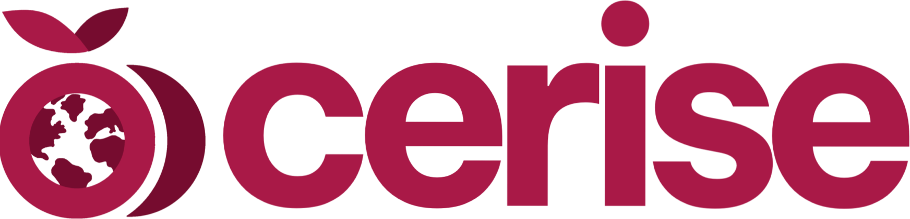
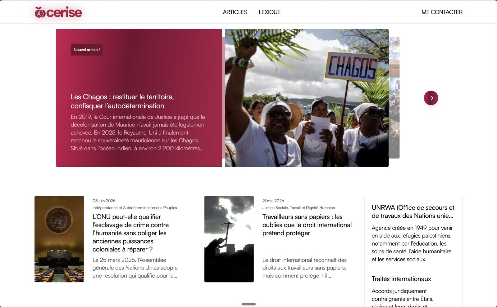

  <picture>
    <source media="(prefers-color-scheme: dark)" srcset=".github/assets/logo-dark.png">
    
  </picture>

<h3 align="center">Le média indépendant des droits humains, de la justice sociale et des conflits internationaux</h3>

  

 

La Cerise est un média journalistique francophone en ligne. Il publie des articles d'analyse et de terrain sur les sujets que l'actualité traite trop vite.

  <a href="https://lacerise.blog"><strong>Lire La Cerise</strong></a>

  

---

Conçu et développé par <a href="https://sevyns.fr">Yves Nsabimana</a>

